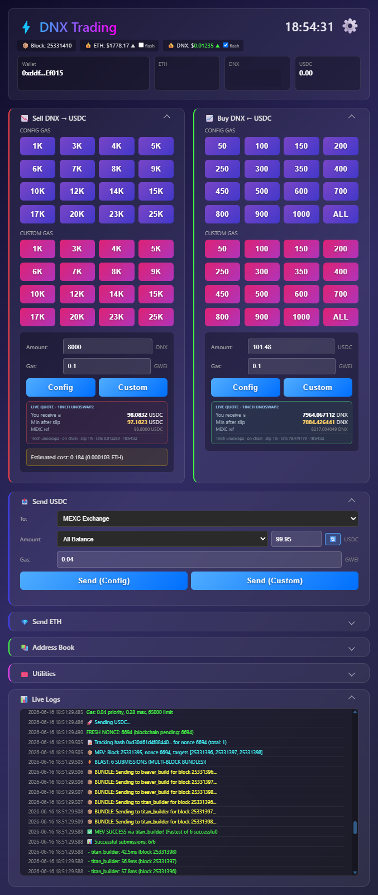
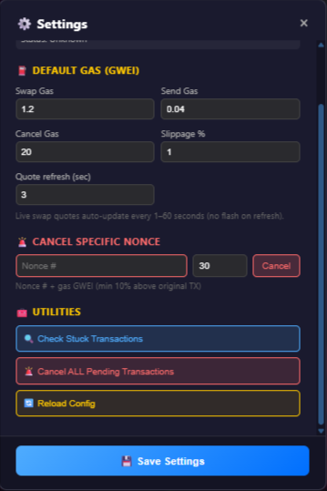

# DEX Swapper

A focused swap can become a sequence of wallet dialogs, quote checks and separate transaction tools. DEX Swapper brings the supported DNX and USDC workflow into an operator desk with quotes, trade presets and transaction follow-up close together.

## Tech stack

| Layer | Technologies |
|---|---|
| Application | Python, FastAPI |
| Supporting technologies | HTML, CSS, JavaScript; Ethereum, Uniswap; Web3.py |

## Keep the trading context visible

The header shows the relevant chain and wallet context while buy and sell controls remain within the same workspace. Live quotes help the operator inspect the proposed conversion before choosing an action. The desk is focused on the configured market rather than a general token directory.

The trading desk keeps the selected market, wallet and proposed conversion in view at the same time. That context matters when moving between a quote and the controls that would act on it.

## Use presets for repeated work

Preset amounts reduce repetitive typing when comparing or carrying out familiar trade sizes. Directional buy and sell areas keep the intended action clear. Quote information and transaction preferences remain available for a deliberate final decision.

Presets provide a convenient starting point for familiar amounts while leaving the proposed action visible for review. They reduce repeated entry without replacing the final amount and direction decision.

## Manage transfers and contacts

Token and native-asset send controls cover related wallet tasks, while an address book helps reuse intended recipients. Keeping these tools beside swap operations reduces the need to open another utility for routine follow-up. Destinations and amounts remain decisions for the operator.

The address book is useful when the same recipients return in normal wallet work. Review the selected recipient alongside the amount before using the send controls.

## Follow and recover transactions

Live logs and utility controls help inspect what happened after submission. Gas and transaction-management options support cases that need more attention, including cancellation-related work. Protective routing choices are available for supported execution paths without promising immunity from trading risk.

A submitted action may need follow-up rather than another submission. Transaction information and logs provide a place to inspect that situation before using the available recovery controls.

## Configure the operating desk

Settings cover connection preferences, gas defaults and the supported display or execution choices.

Connection and gas preferences form part of the operator's working environment. Keeping them in a dedicated area makes it easier to revisit the setup without crowding the main trading task.

---

Private code: [dex-swapper](https://github.com/logicencoder/dex-swapper)

See [REPOS.md](REPOS.md) for related repositories.

**[Logic Encoder](https://logicencoder.com)** · [GitHub](https://github.com/logicencoder) · [Contact](https://logicencoder.com/contact/)
