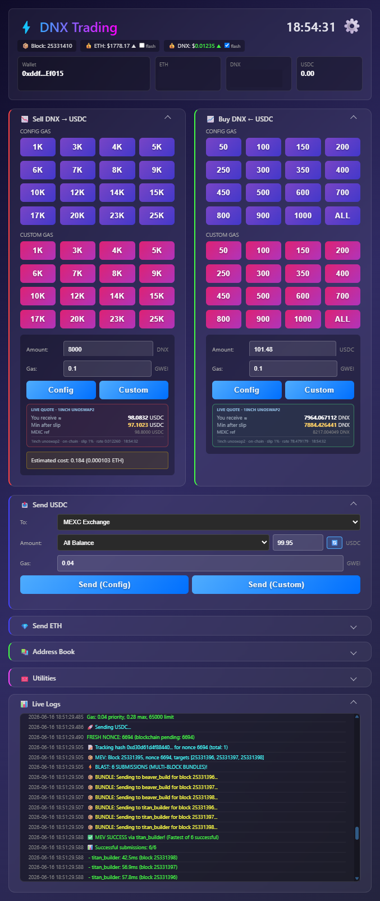
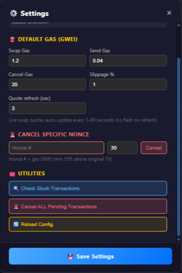

# DEX Swapper

A focused swap can become a sequence of wallet dialogs, quote checks and separate transaction tools. DEX Swapper brings the supported DNX and USDC workflow into an operator desk with quotes, trade presets and transaction follow-up close together.

## Tech stack

| Layer | Technologies |
|---|---|
| Application | Python, FastAPI |
| Supporting technologies | HTML, CSS, JavaScript; Ethereum, Uniswap; Web3.py |

## Keep the trading context visible

The header shows the relevant chain and wallet context while buy and sell controls remain within the same workspace. Live quotes help the operator inspect the proposed conversion before choosing an action. The desk is focused on the configured market rather than a general token directory.

The trading desk keeps the selected market, wallet and proposed conversion in view at the same time. That context matters when moving between a quote and the controls that would act on it.

## Use presets for repeated work

Swap buttons carry preset sizes from 10,000 to 25,000 DNX in two rows: one swaps with the gas settings from the configuration, the other with a custom gas value typed beside it. A quote request shows the proposed conversion before anything is submitted, and the slippage limit and quote refresh interval are set in Settings.

Presets provide a convenient starting point for familiar amounts while leaving the proposed action visible for review. They reduce repeated entry without replacing the final amount and direction decision.

## Manage transfers and contacts

USDC and ETH can be sent from the same screen, either with a preset amount (100 up to 1,000, or ALL) using the configured gas or a custom value. The address book stores named recipients (for example an exchange deposit address) that can be added, removed and chosen from a list.

The address book is useful when the same recipients return in normal wallet work. Review the selected recipient alongside the amount before using the send controls.

## Follow and recover transactions

A live log streams over a WebSocket. Stuck-transaction tools check pending nonces over a chosen number of blocks or for specific nonce numbers, cancel one nonce or all pending transactions with a replacement at higher gas, and a **Cancel current swap** button stops a swap in flight. Swaps are submitted through MEV builders, which reduces exposure to public-mempool front-running without removing it.

A submitted action may need follow-up rather than another submission. Transaction information and logs provide a place to inspect that situation before using the available recovery controls.

## Configure the operating desk

Settings hold separate gas values for swaps, sends and cancellations with an extra priority fee, the slippage limit, the quote refresh interval, a reload of the configuration file and an optional watcher that flags blocks involving a known attacker address. **Node Settings** show the current Ethereum node, switch to another node and test or health-check it.

Connection and gas preferences form part of the operator's working environment. Keeping them in a dedicated area makes it easier to revisit the setup without crowding the main trading task.

---

Private code: [dex-swapper](https://github.com/logicencoder/dex-swapper)

See [REPOS.md](REPOS.md) for related repositories.

**[Logic Encoder](https://logicencoder.com)** · [GitHub](https://github.com/logicencoder) · [Contact](https://logicencoder.com/contact/)
